# SaborExpress

[](https://creativecommons.org/licenses/by-nc-sa/4.0/) [](https://saborexpress-react.netlify.app/)

SaborExpress es una propuesta de e-commerce gastronómico orientada a la venta de pupusas y alimentos tradicionales salvadoreños. El proyecto fue desarrollado como parte de la etapa de cátedra, con el objetivo de poner en práctica conceptos de maquetación web, interacción con JavaScript, trabajo colaborativo y diseño de experiencia de usuario.

La idea principal del sistema es permitir a un cliente navegar el catálogo, elegir productos, gestionar un carrito de compras y realizar un pedido de forma sencilla, además de ofrecer un panel administrativo para administrar el menú y el estado de los pedidos.

---

## 🔗 Enlaces del proyecto

**Entrega final:** la aplicación publicada en Netlify es la versión completa del proyecto. El repositorio conserva también la versión del Foro 1 y contiene **dos versiones** del sitio: la del Foro 1 (HTML, CSS y JavaScript, en las carpetas de la raíz) y la aplicación React del Foro 2 (carpeta `frontend/`).

| Entrega | Sitio publicado | Video de demostración |
| --- | --- | --- |
| Foro 1: HTML, CSS y JavaScript | [Abrir sitio](https://abnerdiazz.github.io/SaborExpress-DAW/) | [Ver video](https://drive.google.com/file/d/1TDZSLtAe6zYHCqH77WyTOrAhEAmyjyy2/view) |
| Foro 2 y entrega final: aplicación React completa | [Abrir sitio](https://saborexpress-react.netlify.app/) | [Ver video](https://drive.google.com/file/d/1_i5_3z2qiql3eq87jH1KtFvsDlK6kHYL/view?usp=drive_link) |

### 🎬 Defensa final en video

[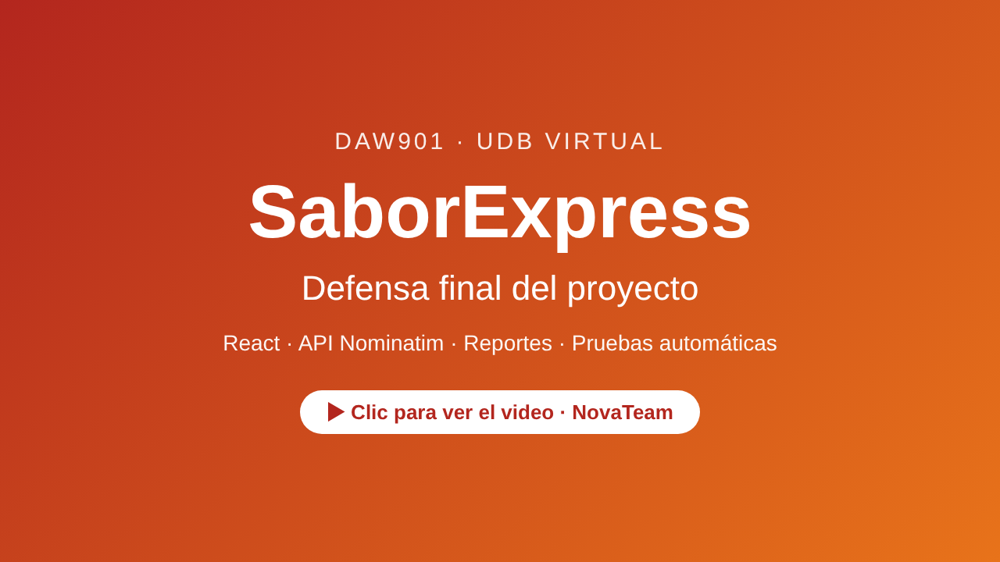](https://drive.google.com/file/d/1Vqa1-puPd_LN_urJKWP7opcYWusM8haw/view?usp=drive_link)

**Ver en Drive:** [https://drive.google.com/file/d/1Vqa1-puPd_LN_urJKWP7opcYWusM8haw/view?usp=drive_link](https://drive.google.com/file/d/1Vqa1-puPd_LN_urJKWP7opcYWusM8haw/view?usp=drive_link)

Documentos de investigación (formato APA 7): [Foro 1: librerías de JavaScript](docs/Investigacion-Librerias-Foro1.pdf) · [Foro 2: React y la API Nominatim](docs/Investigacion-React-Foro2.pdf)

---

## 🎨 Mockups de Figma (Etapa 1)

Diseño de las vistas principales, elaborado en Figma durante la Etapa 1: [abrir el archivo de Figma](https://www.figma.com/design/nTGOi2J5tq3bWxbWwutViB/Untitled?node-id=0-1&t=vN3KPfjG4rG4PCW4-1). La aplicación final sigue estas pantallas (barra de navegación, tarjetas, tablas, colores y estados) y las amplía con las vistas que se añadieron después (Inicio, Nosotros, Contacto, Registro, Checkout, Menú y Mensajes del administrador).

### Vistas del cliente

| Inicio de sesión | Menú |
| --- | --- |
| 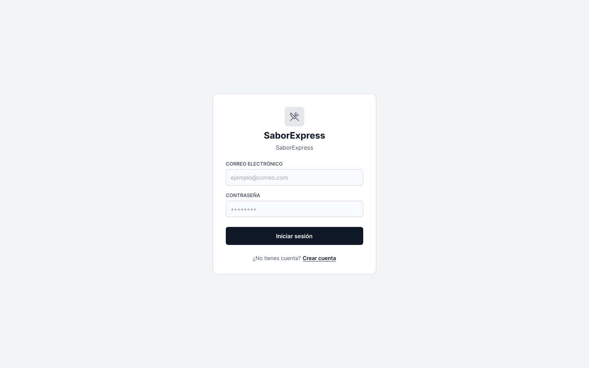 | 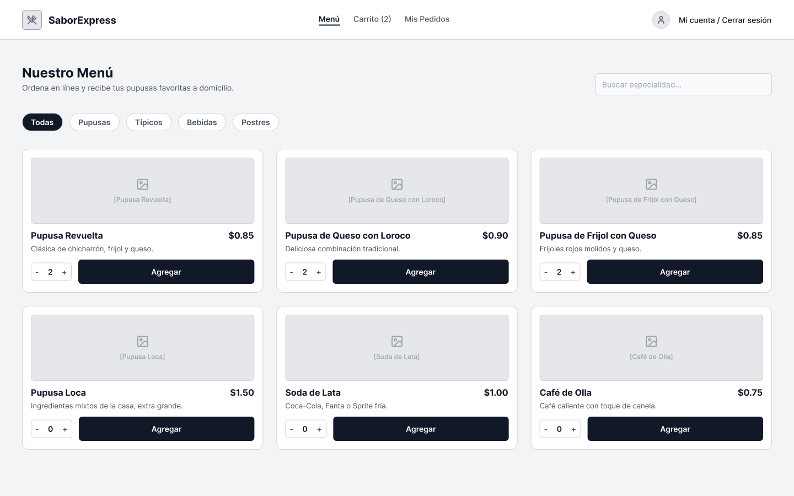 |

| Carrito | Mis pedidos |
| --- | --- |
| 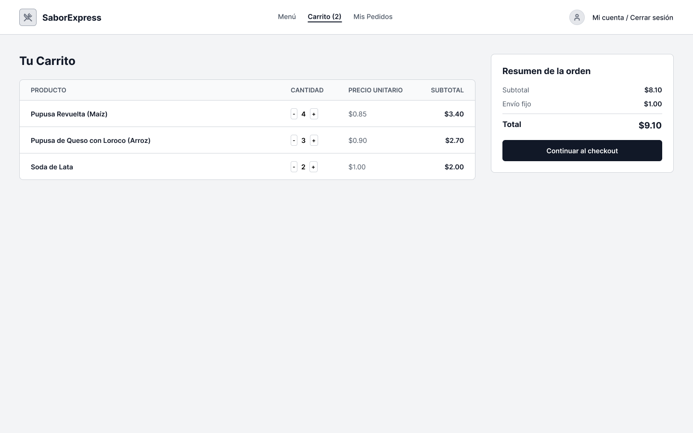 | 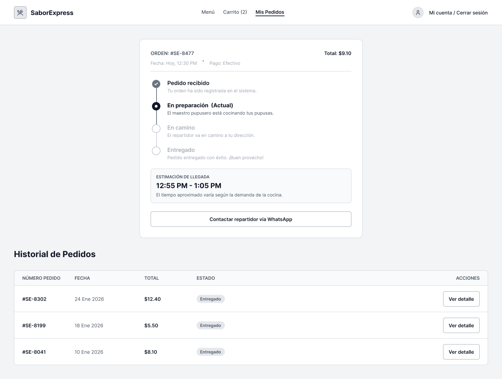 |

### Vista del administrador

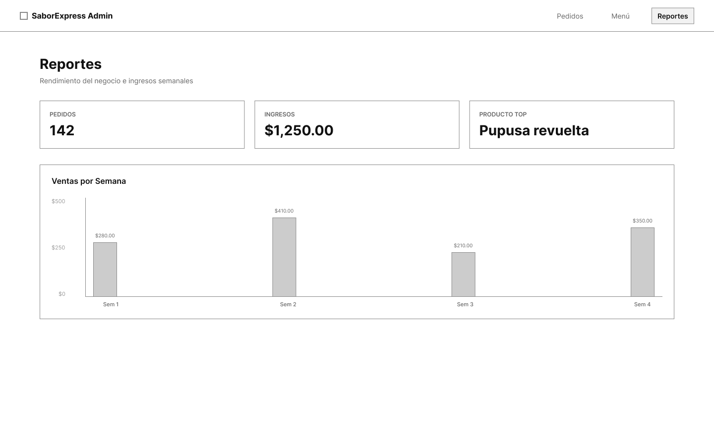

### Arquitectura propuesta y diagramas de flujo

La propuesta de la Etapa 1 contemplaba React, la API Nominatim, Chart.js y `localStorage` para la sesión. En la implementación final los datos se guardan en `localStorage` (como indica el requisito de seguridad básica del proyecto) y no se usa un servicio de base de datos externo, por lo que no hay credenciales que proteger en el repositorio público.

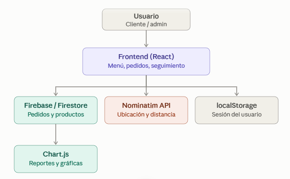

| Flujo del pedido (1/2) | Flujo del pedido (2/2) |
| --- | --- |
| 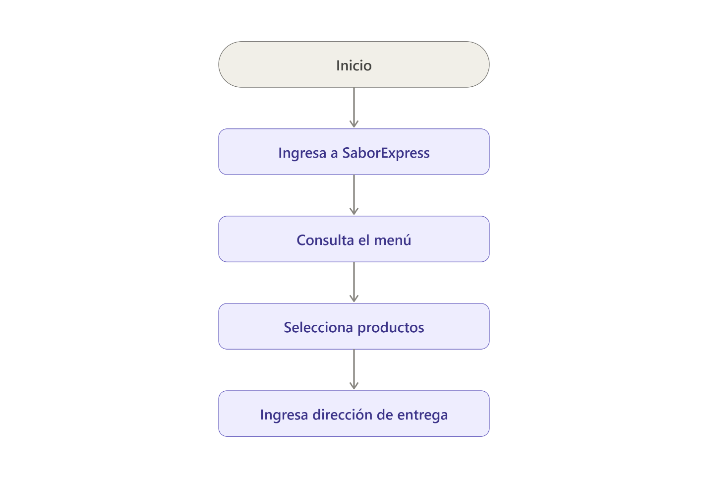 | 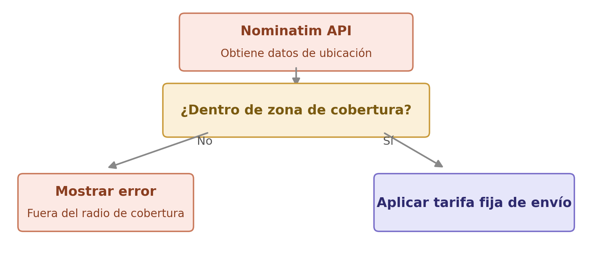 |

| Confirmación | Estados del pedido | Cierre |
| --- | --- | --- |
| 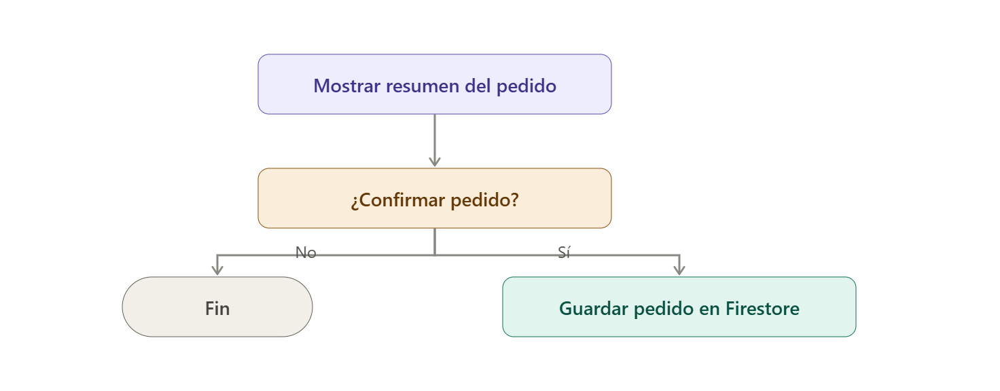 | 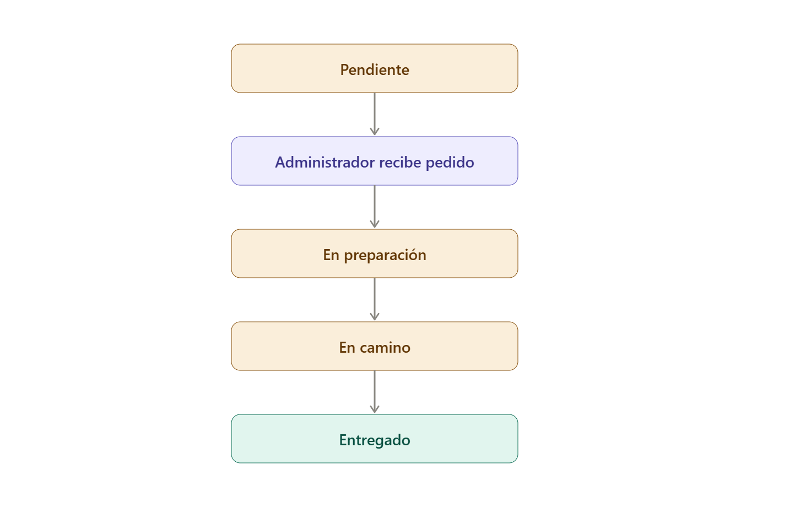 |  |

### Arquitectura de componentes de la aplicación React

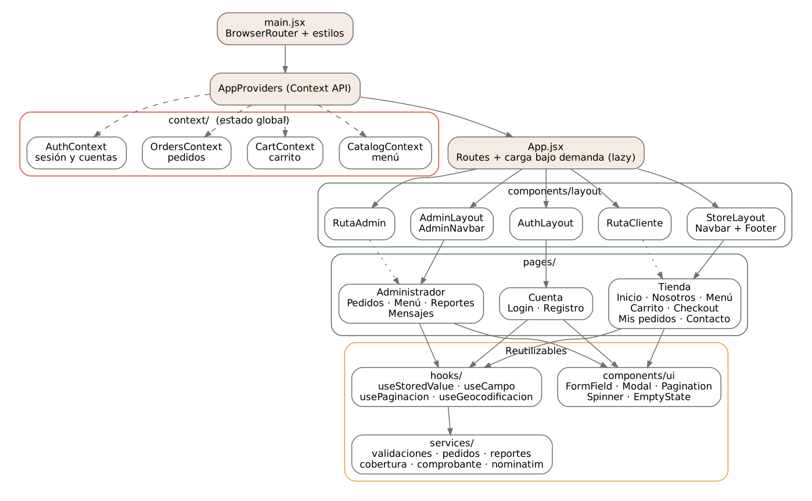

---

## ✅ Entrega final: requisitos y cómo se cumplen

| # | Requisito de la entrega final | Cómo se cumple | Dónde |
| --- | --- | --- | --- |
| 1 | Aplicación desplegada en hosting gratuito | Netlify (React) y GitHub Pages (Foro 1) | [saborexpress-react.netlify.app](https://saborexpress-react.netlify.app/) |
| 2 | Framework JS en toda la aplicación | React 19 con React Router: las 13 pantallas son componentes de React | `frontend/src/pages`, `frontend/src/components` |
| 3 | API externa con datos integrados al flujo | Nominatim (OpenStreetMap) en el checkout: busca direcciones y obtiene la dirección del punto marcado | `frontend/src/services/nominatim.js` |
| 4 | Módulos principales y secundarios | Principales: catálogo, carrito y checkout, cuenta, pedidos, panel del administrador. Secundarios: reportes, mensajes de contacto, contacto y nosotros | `frontend/src/pages` |
| 5 | Reportes con gráfica dinámica | Cuatro gráficas de Chart.js con filtros de fechas, detalle por día y exportación CSV | `frontend/src/pages/admin/ReportesPage.jsx` |
| 6 | UX/UI profesional y responsive, coherente con Figma | Bootstrap 5 y estilos propios; revisada en 360, 768 y 1280 px sin desbordes | sección Mockups de este README |
| 7 | Mockups en el README | Sección **Mockups de Figma** | este documento |
| 8 | Licencia Creative Commons | CC BY-NC-SA 4.0 | archivo [`LICENSE`](LICENSE) |
| 9 | Repositorio con rama por alumno, colaboradores y README | Una rama por integrante, todos colaboradores, cambios por Pull Request | sección **Equipo y flujo de trabajo** |

### Seguridad básica

- **Validación de entradas** en todos los formularios (inicio de sesión, registro, contacto, checkout y administración), campo por campo.
- **Sesiones** con `localStorage`, independientes para cliente y administrador; las rutas del panel exigen el rol de administrador.
- **Sin secretos en el repositorio:** no hay claves de API (Nominatim no las requiere) y `.env` está en `.gitignore`. La cuenta de administrador de abajo es solo de demostración.
- El texto que escribe un cliente se escapa antes de mostrarse en los paneles, para evitar inyección de HTML.
- Una prueba automática (`requisitos-finales.test.js`) revisa la licencia, el README, las rutas, los roles y que no haya secretos en el código.

---

## ✨ Descripción general del proyecto

El sitio se compone de varias páginas funcionales que simulan un flujo real de compra en una pupusería:

- Página principal con presentación del negocio y mensajes de promoción.
- Menú interactivo con filtros, búsqueda y paginación.
- Carrito de compras con control de cantidades y resumen de pedido.
- Proceso de registro e inicio de sesión.
- Sección de pedidos del cliente para consultar el estado de sus compras.
- Panel administrativo para gestionar productos y cambiar el estado de los pedidos.
- Área de reportes con gráficas interactivas para analizar la operación.
- Diálogos de confirmación y avisos con SweetAlert2, validación de formularios campo por campo y comprobante de pedido en PDF.
- Zona de cobertura de entregas sobre un mapa interactivo.
- Aplicación React (Foro 2) que consume una API externa real (Nominatim), con estado global, componentes reutilizables y 203 pruebas automáticas.

El enfoque del proyecto no fue crear un backend real, sino presentar una solución frontend completa con almacenamiento local mediante `localStorage`, lo cual permite simular persistencia de datos sin necesidad de una base de datos o servidor externo.

---

## 👥 Integrantes del equipo

- Abner Isaí Díaz Rivera — DR261575
- Marlene Yamileth Pérez Alvarado — PA261400
- Elias Grande Beltrán — GB261371
- Jason Steven Durán López — DL261125
- Blanca Margarita Rivas Sandoval — RS260234

El trabajo fue desarrollado en conjunto, distribuyendo tareas según los módulos del proyecto: estructura visual, estilos, lógica de JavaScript, flujo de compra, panel administrativo y documentación final.

---

## 🎯 Objetivo del sistema

El proyecto busca demostrar la capacidad del equipo para:

- diseñar una interfaz moderna y funcional para una tienda en línea;
- organizar la navegación entre páginas y secciones del sitio;
- implementar interacciones con JavaScript sin dependencias pesadas;
- manejar datos del usuario y del catálogo en el navegador;
- aplicar buenas prácticas de UX en un proyecto de tipo e-commerce institucional;
- presentar un entregable profesional de cátedra con una solución completa y coherente.

---

## 🧩 Stack tecnológico

El proyecto se desarrolló principalmente con tecnologías web estándar:

- HTML5 para la estructura de las páginas.
- CSS3 para el diseño visual y la responsividad.
- JavaScript moderno (ES Modules) para la lógica de la aplicación.
- Bootstrap 5 para la base visual y componentes reutilizables.
- Bootstrap Icons para los iconos de la interfaz.
- LocalStorage como mecanismo de persistencia de datos del navegador.
- Chart.js 4 para las gráficas del panel de reportes.
- Leaflet 1.9 y OpenStreetMap para el mapa del checkout y la zona de cobertura.
- SweetAlert2 11 para los diálogos de confirmación, avisos y formularios emergentes.
- jsPDF 2.5 para generar el comprobante del pedido en PDF.

En el sitio del Foro 1 no se empleó un framework de interfaz ni una arquitectura backend, ya que el objetivo de esa etapa era enfocarse en la lógica del front-end y la experiencia del usuario. Las librerías externas se cargan desde CDN; SweetAlert2 y jsPDF se cargan solo cuando se necesitan y, si no hay conexión, la aplicación usa los cuadros nativos del navegador.

### Aplicación React (Foro 2)

- React 19 y Vite para la interfaz y las herramientas de desarrollo.
- React Router para la navegación y las rutas protegidas por rol.
- Context API y hooks propios para el estado global (sesión, catálogo, carrito y pedidos).
- react-chartjs-2 (Chart.js) para las gráficas y react-leaflet (Leaflet) para el mapa.
- SweetAlert2, jsPDF, Bootstrap 5 y Bootstrap Icons como paquetes npm, sin depender de un CDN.
- API Nominatim (OpenStreetMap) para buscar direcciones y obtener la dirección de un punto del mapa.
- Vitest y React Testing Library para las pruebas automáticas.
- Netlify para la publicación.

---

## 📁 Estructura del proyecto

```text
SaborExpress-DAW/
├── admin-menu.html
├── admin-pedidos.html
├── admin-reportes.html
├── carrito.html
├── checkout.html
├── contacto.html
├── index.html
├── login.html
├── menu.html
├── mis-pedidos.html
├── nosotros.html
├── registro.html
├── css/
│   ├── admin-reportes.css
│   ├── carrito-adminmenu.css
│   ├── contacto-adminpedidos.css
│   ├── inicio-nosotros.css
│   ├── login-mispedidos.css
│   └── menu-reportes.css
├── LICENSE                    (Creative Commons BY-NC-SA 4.0)
├── docs/
│   ├── mockups/               (mockups de Figma y diagramas de flujo)
│   ├── capturas/              (capturas y diagrama de componentes)
│   ├── modulos/               (documentación técnica de cada módulo)
│   ├── Investigacion-Librerias-Foro1.pdf
│   └── Investigacion-React-Foro2.pdf
├── img/
│   ├── capturas/
│   ├── comida/
│   ├── contacto/
│   ├── inicio/
│   ├── menú/
│   └── nosotros/
├── js/
│   ├── admin-menu.js          (CRUD del menú con SweetAlert2)
│   ├── admin-pedidos.js       (estados de pedidos, paginación)
│   ├── admin-reportes.js      (panel de reportes)
│   ├── alertas.js             (capa de diálogos SweetAlert2)
│   ├── carrito-sync.js        (el carrito se ajusta al menú vigente)
│   ├── carrito.js
│   ├── checkout.js            (validaciones, zona de cobertura, confirmación)
│   ├── cobertura.js           (local, radio de entrega y distancia)
│   ├── compra-utils.js        (tarifa de envío, límites y utilidades)
│   ├── comprobante.js         (comprobante en PDF con jsPDF)
│   ├── contacto.js
│   ├── inicio-nosotros.js
│   ├── login.js
│   ├── menu.js
│   ├── mis-pedidos.js
│   ├── registro.js
│   ├── reportes-demo.js       (datos de demostración para las gráficas)
│   ├── reportes-graficas.js   (gráficas Chart.js)
│   ├── saborexpress-data.js   (acceso a datos, sesiones y navbar)
│   └── validaciones.js        (reglas de validación reutilizables)
├── frontend/                  (Foro 2: aplicación React con Vite)
│   ├── index.html
│   ├── package.json
│   ├── vite.config.js
│   ├── public/                (_redirects e img/)
│   └── src/
│       ├── pages/             (una pantalla por ruta)
│       ├── components/        (piezas reutilizables, por módulo)
│       ├── context/           (estado global)
│       ├── hooks/             (hooks propios)
│       ├── services/          (lógica sin React y cliente de la API)
│       ├── styles/
│       └── test/              (203 pruebas automáticas)
├── netlify.toml               (configuración de publicación en Netlify)
└── README.md
```

---

## 🛠️ Funcionalidades principales

### 1. Catálogo del menú
El módulo principal del cliente permite:

- visualizar productos con nombre, descripción, imagen y precio;
- filtrar por categorías;
- buscar productos por nombre o descripción;
- seleccionar cantidades antes de agregar al carrito;
- paginar el contenido cuando hay varios artículos.

### 2. Carrito de compras
La funcionalidad del carrito incluye:

- adicionar productos con distintas cantidades;
- mantener los datos almacenados en el navegador;
- mostrar el total acumulado;
- permitir edición antes de confirmar la compra.

### 3. Registro e inicio de sesión
La aplicación gestiona usuarios locales con base en `localStorage`, permitiendo:

- crear cuenta nueva;
- iniciar sesión con correo y contraseña;
- redirigir según el tipo de usuario;
- mantener la sesión activa durante la navegación.

### 4. Proceso de checkout
Cuando el cliente confirma su pedido, el sistema genera una orden con información de:

- cliente;
- dirección;
- teléfono;
- método de pago;
- productos seleccionados;
- total final.

Antes de confirmar se valida cada campo, se pide marcar la ubicación en el mapa y se comprueba que esté dentro de la **zona de cobertura** (5 km alrededor del local, con tarifa de envío fija). Al confirmar, el cliente puede descargar el comprobante en PDF y enviar el detalle por WhatsApp.

### 5. Mis pedidos
Los clientes pueden consultar el historial de sus compras y observar el estado actualizado por el administrador.

### 6. Panel administrativo
El admin cuenta con herramientas para:

- administrar el menú público;
- agregar productos desde un catálogo base;
- editar precios y nombres;
- eliminar productos no deseados;
- filtrar pedidos por estado;
- cambiar el estado de cada pedido (Pendiente, Preparando, En camino, Entregado, Cancelado); Entregado y Cancelado son estados finales y piden confirmación;
- ocultar o mostrar productos sin eliminarlos;
- leer y gestionar los mensajes de contacto;
- recibir los pedidos nuevos sin recargar la página.

### 7. Mensajes de contacto (administrador)
Los mensajes que los clientes envían desde Contacto llegan a una bandeja del administrador: se pueden filtrar (todos, sin leer, leídos), buscar, leer completos, marcar como leídos o sin leer, responder por correo y eliminar con confirmación. Al responder, el correo se abre ya dirigido al cliente, con el asunto "Re: …", un saludo, un agradecimiento general elegido al azar (que se puede editar) y la firma del equipo SaborExpress; también hay un botón para abrirlo en Gmail con la cuenta del negocio. del administrador muestra cuántos mensajes están sin leer y se actualiza sola.

### 8. Reportes
La sección administrativa incluye cuatro gráficas de Chart.js (ventas por día, pedidos por día, ingresos por categoría y estado de los pedidos), indicadores clave, filtros por rango de fechas y exportación a CSV (resumen por categoría y detalle de pedidos). Al hacer clic en una barra de ventas se abre el detalle de los pedidos de ese día. Para pruebas y demostraciones, el panel permite generar y quitar pedidos de ejemplo claramente identificados, sin tocar los pedidos reales.

---

## 🔐 Credenciales de demostración

Para ingresar al panel administrativo del proyecto, se usa la siguiente cuenta de prueba:

- Correo: `admin@saborexpress.com`
- Contraseña: `Admin123`

> Estas credenciales están diseñadas para pruebas del proyecto y están integradas con la lógica de autenticación local del sistema.

Los clientes se registran desde `registro.html` (contraseña de mínimo 8 caracteres, con letras y números). Las sesiones de cliente y de administrador son independientes, por lo que se pueden probar ambos roles a la vez en el mismo navegador.

---

## ▶️ Cómo ejecutar el proyecto

Hay dos versiones: la del Foro 1 es estática y no requiere instalación, y la aplicación React (Foro 2 y entrega final) usa Node.js.

### Sitio del Foro 1: con Live Server (recomendado)

1. Abre la carpeta del proyecto en Visual Studio Code.
2. Instala la extensión **Live Server**.
3. Haz clic derecho sobre `index.html` y elige **Open with Live Server**.

> El proyecto usa módulos de JavaScript (`type="module"`), por lo que **no funciona abriendo el HTML con doble clic** (`file://`): debe servirse desde un servidor local o desde el sitio publicado. Se necesita conexión a internet para cargar Bootstrap y las librerías.

### Aplicación React (Foro 2)

Requiere Node.js 20.19 o superior. Desde la raíz del repositorio:

```
cd frontend
npm install
npm run dev      # http://localhost:5173
npm test         # 203 pruebas automáticas
npm run build    # versión de producción en frontend/dist
```

Los enlaces de los sitios publicados y de los videos están en la sección **Enlaces del proyecto**, al inicio de este documento.

---

## 📚 Foro 1: interactividad con librerías de JavaScript

| Requerimiento | Cómo se cumple | Archivos |
| --- | --- | --- |
| Reportes con gráficas funcionales | Cuatro gráficas de Chart.js que se actualizan con los filtros de fecha; clic en una barra abre el detalle del día. | `admin-reportes.html`, `js/admin-reportes.js`, `js/reportes-graficas.js` |
| Diálogos atractivos | SweetAlert2 reemplaza a `alert`, `confirm` y `prompt` en todo el sitio, con avisos breves (toast) y formularios emergentes. | `js/alertas.js` y todas las páginas con acciones |
| Módulo adicional funcional | Zona de cobertura sobre mapa Leaflet (radio de 5 km, distancia calculada con Haversine) y comprobante de pedido en PDF con jsPDF. | `js/checkout.js`, `js/cobertura.js`, `js/comprobante.js` |
| Validaciones avanzadas | Validación por campo y en vivo, formato automático del teléfono, medidor de seguridad de contraseña, bloqueo tras 5 intentos fallidos de inicio de sesión, límites por producto y reglas de estados finales. | `js/validaciones.js`, `js/login.js`, `js/registro.js`, `js/checkout.js`, `js/contacto.js` |
| Documento de investigación (APA 7) | Explica cada librería, por qué se eligió y dónde se aplica en SaborExpress. | `docs/Investigacion-Librerias-Foro1.pdf` |

Extras de experiencia de usuario: los paneles se actualizan solos cuando otra pestaña cambia los pedidos (evento `storage`), y el carrito se ajusta si el administrador oculta un producto o cambia su precio.

---

## ⚛️ Foro 2: aplicación React con API externa

En el Foro 2 el sitio se reconstruyó como una aplicación de una sola página con **React 19** y **Vite**, dentro de la carpeta `frontend/`. El sitio del Foro 1 se conserva sin cambios. Las reglas de negocio se mantienen: envío fijo de $1.00, zona de entrega de 5 km, tope de 20 unidades por producto, estados finales de pedido y dos sesiones independientes (cliente y administrador).

### Qué pide el Foro 2 y cómo se cumple

| Requerimiento | Cómo se cumple | Dónde |
| --- | --- | --- |
| Framework JavaScript integrado | React 19 con Vite: trece pantallas y más de veinte componentes reutilizables | `frontend/src/pages`, `frontend/src/components` |
| API externa con datos reales | Nominatim (OpenStreetMap): busca una dirección escrita y obtiene la dirección del punto marcado en el mapa. Una consulta por segundo, caché, tiempo máximo, cancelación y mensajes de error | `frontend/src/services/nominatim.js`, `frontend/src/hooks/useGeocodificacion.js` |
| Manejo de estado | Context API (sesión, catálogo, carrito y pedidos) y un hook que mantiene sincronizadas las pestañas del navegador | `frontend/src/context`, `frontend/src/hooks/useStoredValue.js` |
| Componentes reutilizables | Formularios con validación, modal, paginación, barras de navegación, gráficas y mapa | `frontend/src/components` |
| Módulos secundarios | Contacto, Nosotros, Mis pedidos, Reportes y los paneles del administrador | `frontend/src/pages` |
| Pruebas | 203 pruebas con Vitest y Testing Library | `frontend/src/test` |
| Documento de investigación (APA 7) | Explica React, la arquitectura, el estado, la API y las pruebas | `docs/Investigacion-React-Foro2.pdf` |

### Estructura de `frontend/src`

| Carpeta | Contenido |
| --- | --- |
| `pages/` | Una pantalla por ruta (tienda, cuenta y panel de administración) |
| `components/` | Piezas reutilizables, agrupadas por módulo |
| `context/` | Estado global: sesión, catálogo, carrito y pedidos |
| `hooks/` | Hooks propios: almacenamiento reactivo, campos de formulario, paginación y geocodificación |
| `services/` | Lógica sin React: validaciones, pedidos, reportes, cobertura, comprobante PDF y cliente de la API |
| `styles/` | Estilos del sitio |
| `test/` | Pruebas automáticas |

### API externa: Nominatim

En el checkout, al escribir una dirección y pulsar el botón de buscar, la aplicación consulta Nominatim y muestra hasta cinco sugerencias; al elegir una, el pin del mapa se mueve a esa ubicación. Al mover el pin, la aplicación obtiene la dirección de ese punto y la ofrece para el campo de entrega. Respeta la política de uso del servicio (una consulta por segundo y sin autocompletado) y, si la API falla, muestra un mensaje claro, ofrece un botón **Reintentar** y la persona puede escribir la dirección a mano.

### Capturas de la aplicación React

#### Menú público

Búsqueda, filtro por categoría, paginación y tope de 20 unidades por producto.

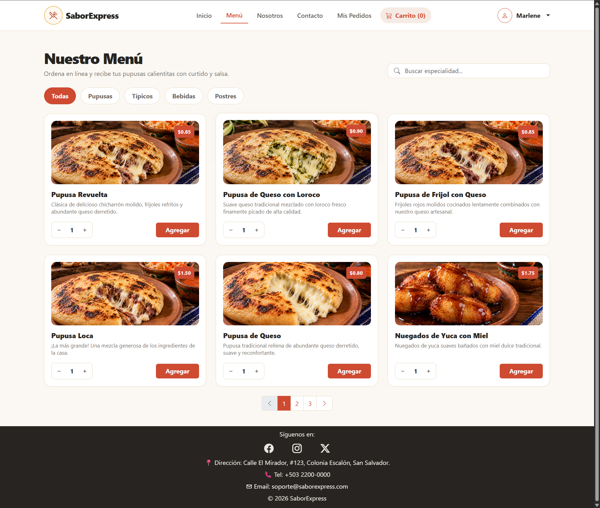

#### Registro con validaciones

Validación por campo, formato automático del teléfono y medidor de seguridad de la contraseña.

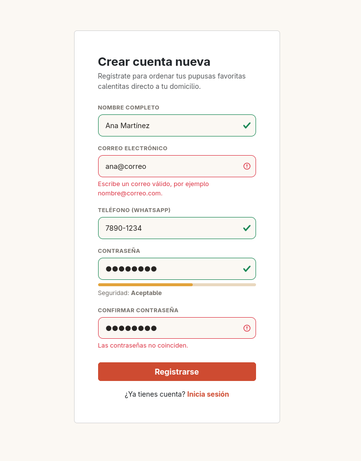

#### Checkout con la API Nominatim

Mapa con la zona de cobertura y la dirección detectada por la API al marcar un punto.

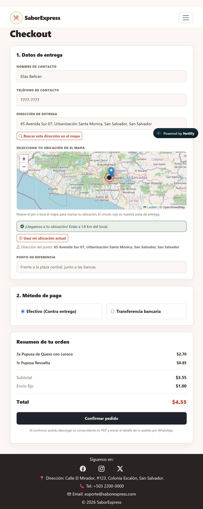

#### Panel de pedidos del administrador

Filtros por estado, paginación y confirmación de los estados finales.

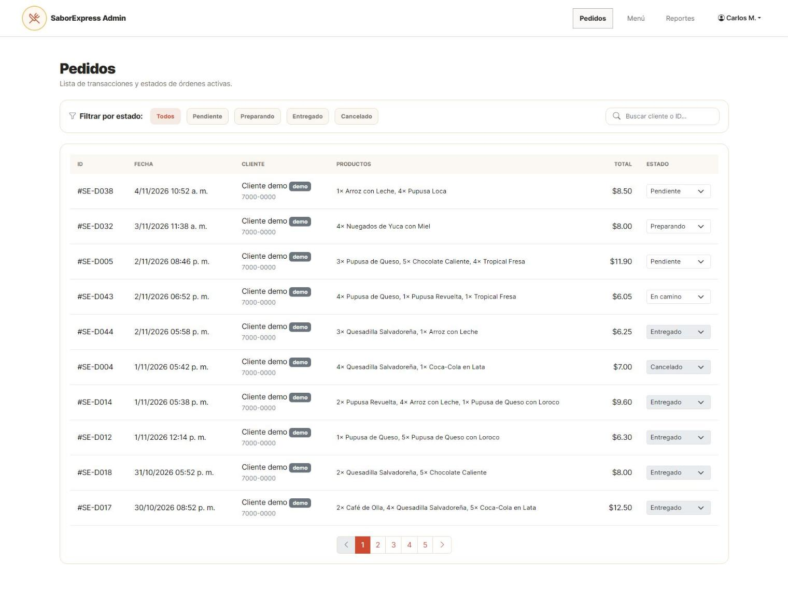

#### Reportes

Cuatro gráficas con react-chartjs-2, detalle por día y exportación a CSV.

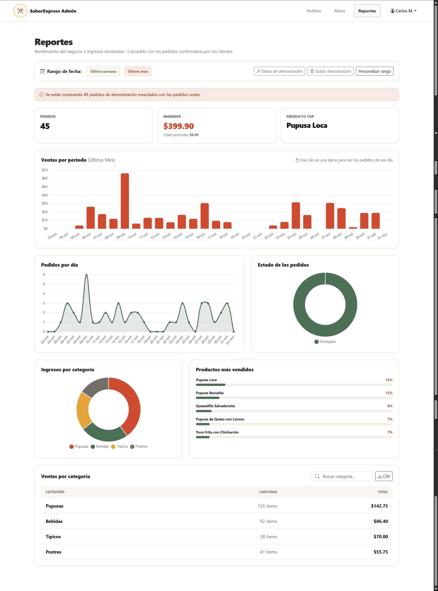

#### Bandeja de mensajes del administrador

Mensajes de Contacto con filtros, insignia de "Nuevo", lectura, marcar como leído y eliminar.

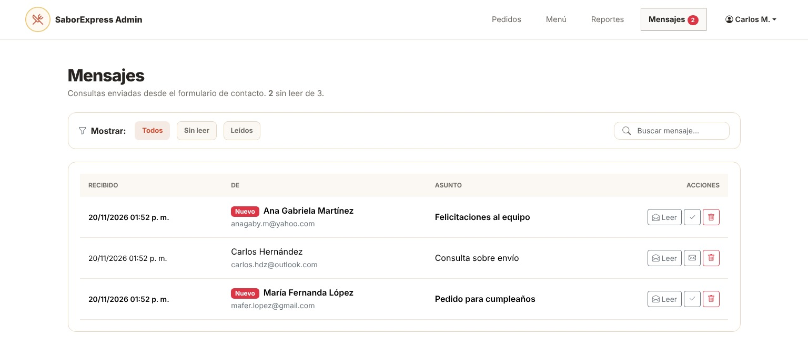

#### Aplicación publicada en Netlify

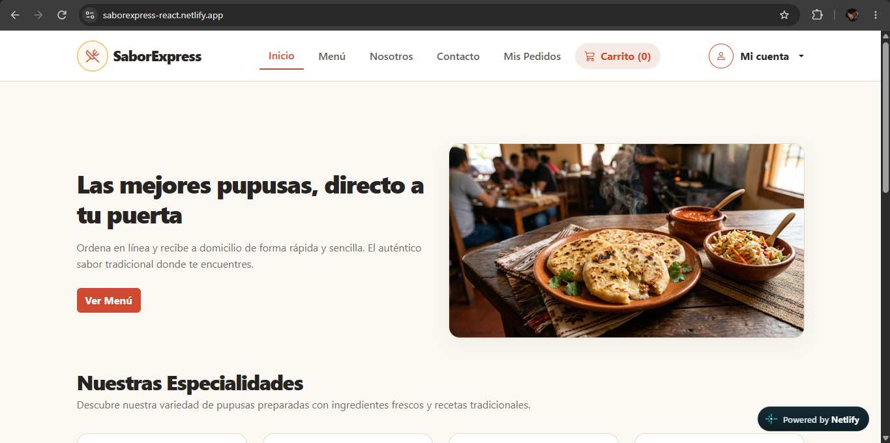

---

## 📸 Capturas del sitio del Foro 1

Las siguientes imágenes muestran las vistas principales del sistema, tanto del lado del cliente como del panel administrativo, en escritorio y en móvil.

### Inicio

Sección principal con la presentación del negocio, llamado a la acción hacia el menú y vista previa de la sección Nosotros.


### Menú

Catálogo de productos con filtros por categoría, buscador, selección de cantidades y paginación.


### Carrito

Resumen de los productos agregados, con control de cantidades, subtotal, envío y total antes de continuar al checkout.


### Mis Pedidos

Seguimiento del pedido en curso con línea de tiempo de su estado, y tabla con el historial de pedidos anteriores del cliente.


### Admin Pedidos

Panel administrativo con filtro por estado, buscador y tabla de todas las órdenes activas del negocio.


### Registro con validaciones (Foro 1)

Validación por campo, formato automático del teléfono y medidor de seguridad de la contraseña.

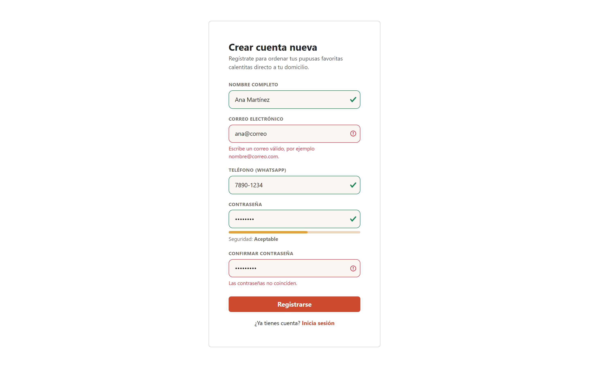

### Checkout con zona de cobertura (Foro 1)

Mapa con el área de entrega, validación por campo y comprobación de la ubicación del cliente.

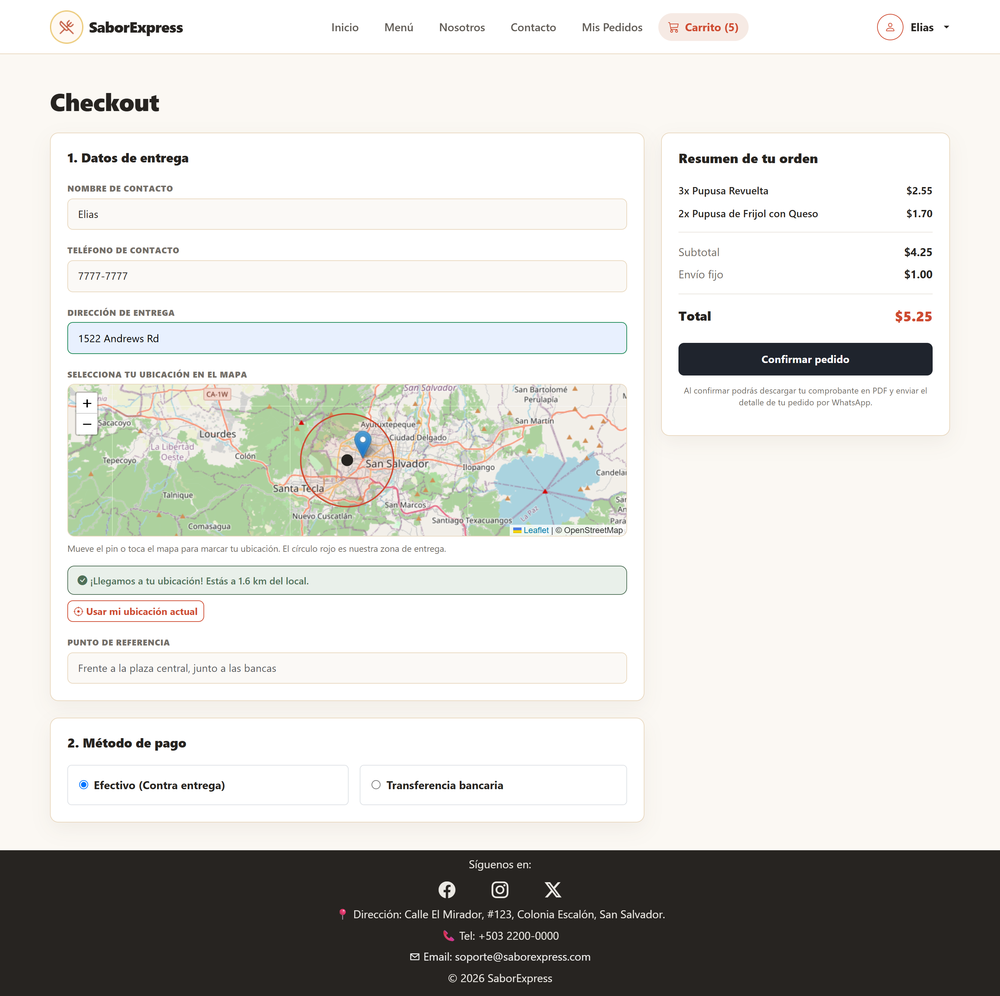

### Confirmación del pedido con SweetAlert2 (Foro 1)

Resumen del pedido que se muestra antes de registrarlo.

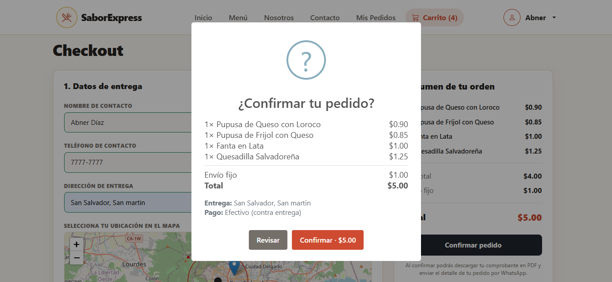

### Comprobante del pedido en PDF (Foro 1)

Comprobante generado con jsPDF al confirmar un pedido.

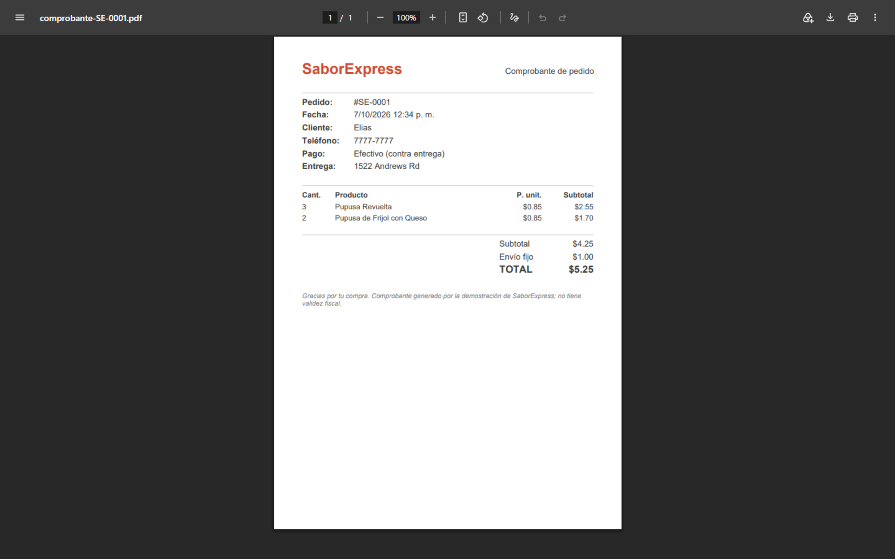

### Admin Pedidos: confirmación de estado final (Foro 1)

Al marcar un pedido como Entregado o Cancelado se pide confirmación, porque son estados finales.

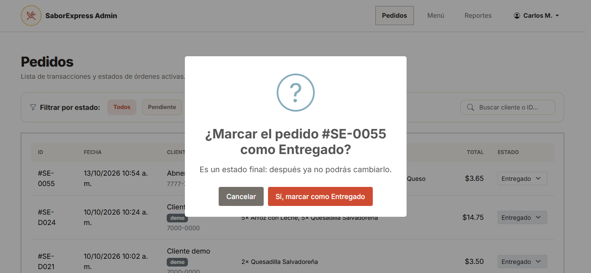

### Admin Menú: edición con validación (Foro 1)

El cuadro de edición rechaza nombres o precios inválidos antes de guardar.

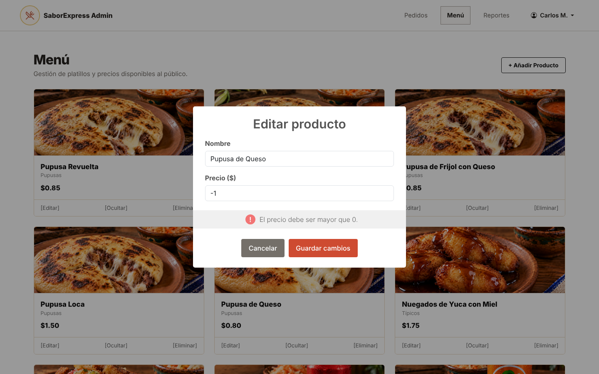

### Reportes (Foro 1)

Panel con indicadores, gráfica de ventas por día, pedidos por día, ingresos por categoría y estado de los pedidos.

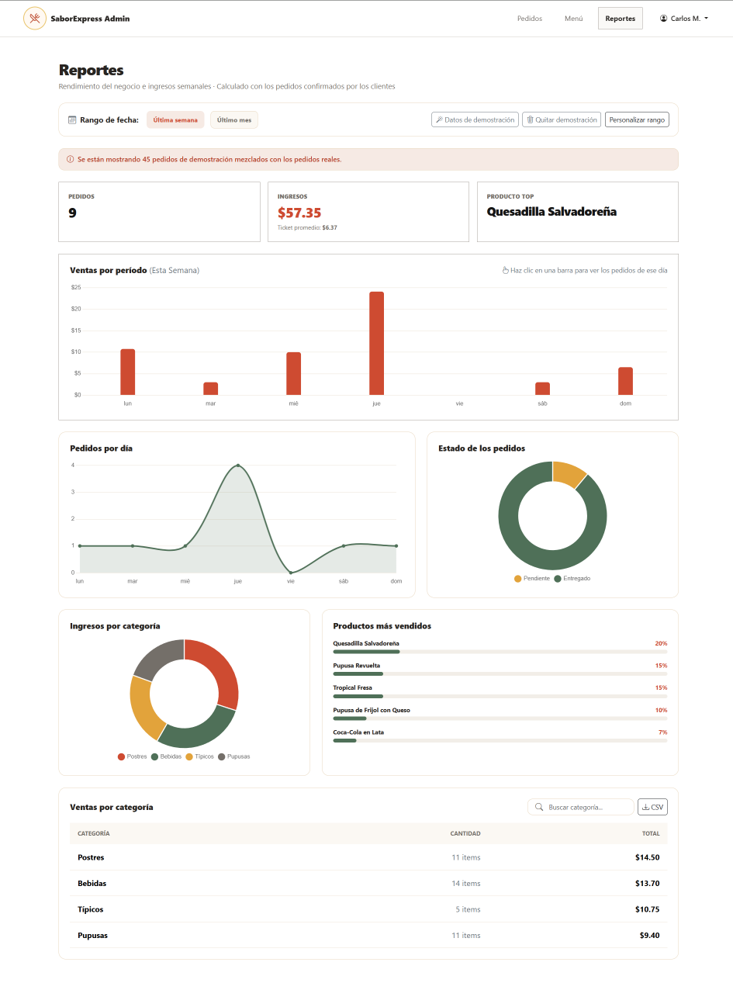

<details>
<summary>Ver estas mismas vistas en móvil</summary>

**Inicio en móvil**


**Menú en móvil**


**Carrito en móvil**


**Mis Pedidos en móvil**


**Admin Pedidos en móvil**


</details>

---

## 📌 Consideraciones técnicas

- La lógica de negocio está concentrada en JavaScript del lado del cliente.
- La persistencia se realiza con `localStorage`, lo que simula almacenamiento de datos sin backend.
- La navegación y los formularios están diseñados para funcionar en un ambiente estático.
- El proyecto está orientado a una experiencia de compra simple y clara, pensada para entregar un demo funcional de negocio digital.
- Ambas versiones guardan los datos en `localStorage`, como indica el requisito de seguridad básica del proyecto (manejo de sesiones con `localStorage` y sin credenciales en el repositorio público). La sincronización entre pestañas del mismo navegador funciona, pero los datos no se comparten entre dispositivos; una base de datos en la nube sería el siguiente paso de crecimiento del sistema.
- La API Nominatim es un servicio público: puede limitar las consultas o no estar disponible, y por eso la aplicación maneja esos errores y permite escribir la dirección a mano.
- La autenticación es simulada: las contraseñas se guardan sin cifrar en `localStorage` y las credenciales del administrador están en el código. Es válido para esta demostración, pero no para producción.

---

## ✅ Estado del proyecto

El proyecto se encuentra desarrollado como una propuesta funcional, con navegación completa, catálogo, carrito, autenticación, gestión administrativa y flujo de pedidos. Existe en dos versiones: el sitio estático del Foro 1 y la aplicación React (Foro 2 y entrega final), que agrega estado global, componentes reutilizables, una API externa, una bandeja de mensajes para el administrador y pruebas automáticas.

Es una solución ideal para demostrar competencias en diseño web, lógica de programación, trabajo en equipo y entrega de un producto con enfoque académico y profesional.

---

## 🤝 Equipo y flujo de trabajo

Cada integrante trabajó en su propia rama (`Abner`, `Marlene`, `Jason`, `Blanca` y `Elias`), con commits descriptivos, y sus cambios entraron a `main` mediante Pull Request con *merge commit*, de modo que el historial muestra quién hizo cada parte. Todos son colaboradores del repositorio.

| Integrante | Rama | Responsabilidad principal |
| --- | --- | --- |
| Abner Isaí Díaz Rivera | `Abner` | Base del proyecto, estado global, navegación, componentes, publicación, README y licencia |
| Marlene Yamileth Pérez Alvarado | `Marlene` | Menú público y panel de reportes con gráficas |
| Jason Steven Durán López | `Jason` | Registro, inicio de sesión y mis pedidos |
| Blanca Margarita Rivas Sandoval | `Blanca` | Contacto, panel de pedidos y menú del administrador, bandeja de mensajes |
| Elias Grande Beltrán | `Elias` | Carrito, checkout, API Nominatim, mapa y comprobante PDF |

La documentación técnica de cada módulo está en [`docs/modulos`](docs/modulos).

---

## 📄 Licencia

Este proyecto se publica bajo la licencia **Creative Commons Atribución-NoComercial-CompartirIgual 4.0 Internacional (CC BY-NC-SA 4.0)**. Puedes copiar, adaptar y compartir el contenido citando al equipo, sin fines comerciales y conservando la misma licencia. El texto completo está en [`LICENSE`](LICENSE) y un resumen en <https://creativecommons.org/licenses/by-nc-sa/4.0/deed.es>. Las librerías de terceros (React, Bootstrap, Chart.js, Leaflet y otras) conservan sus propias licencias.
