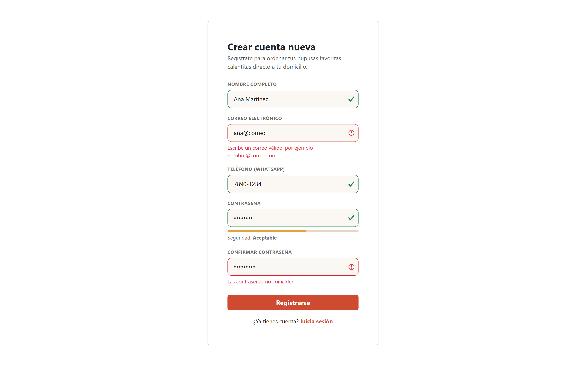
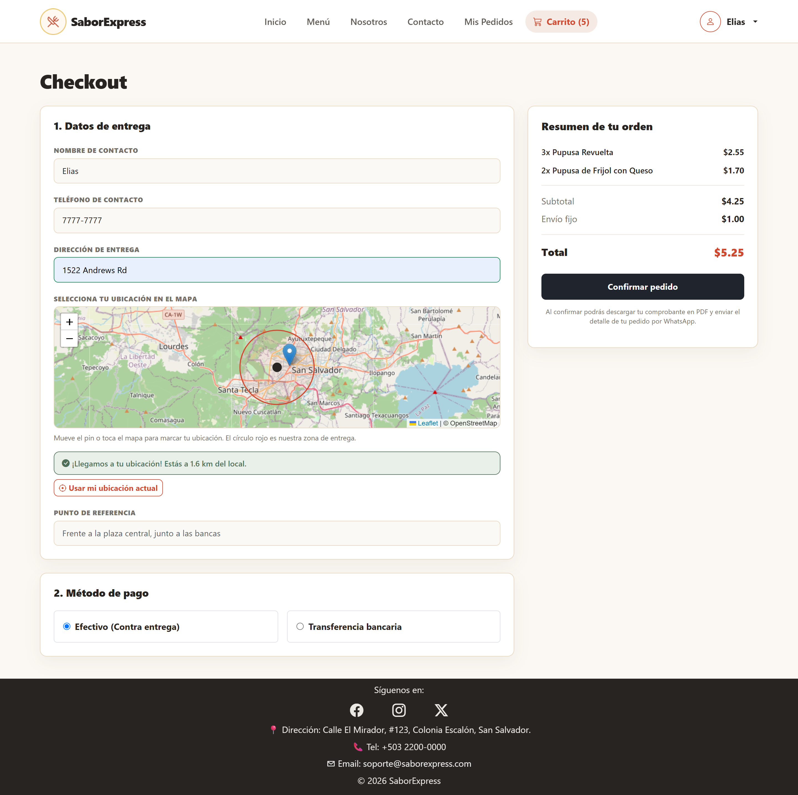
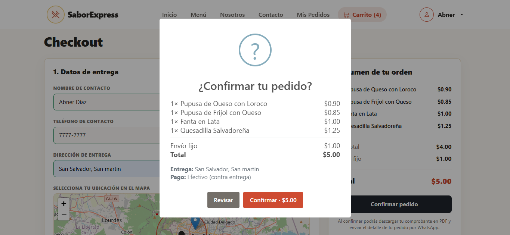
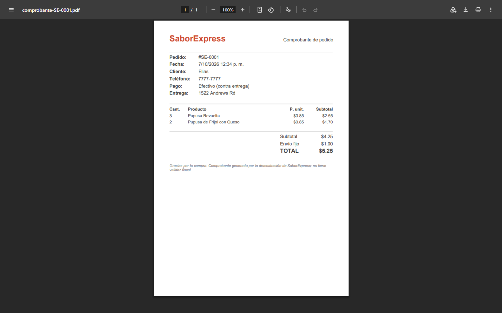
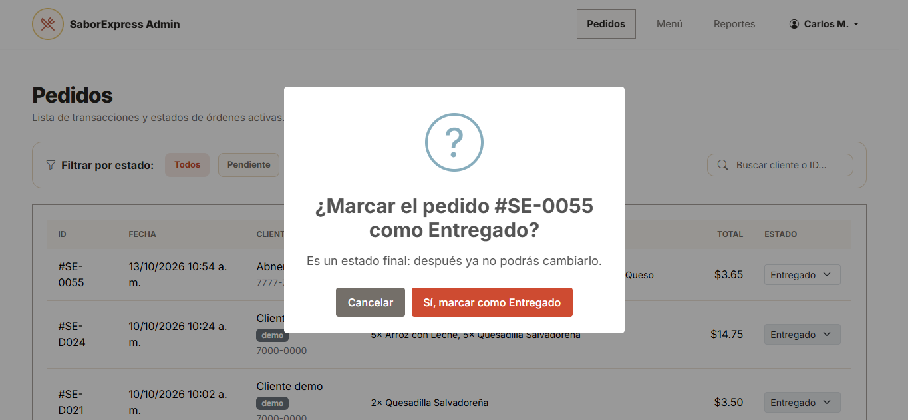
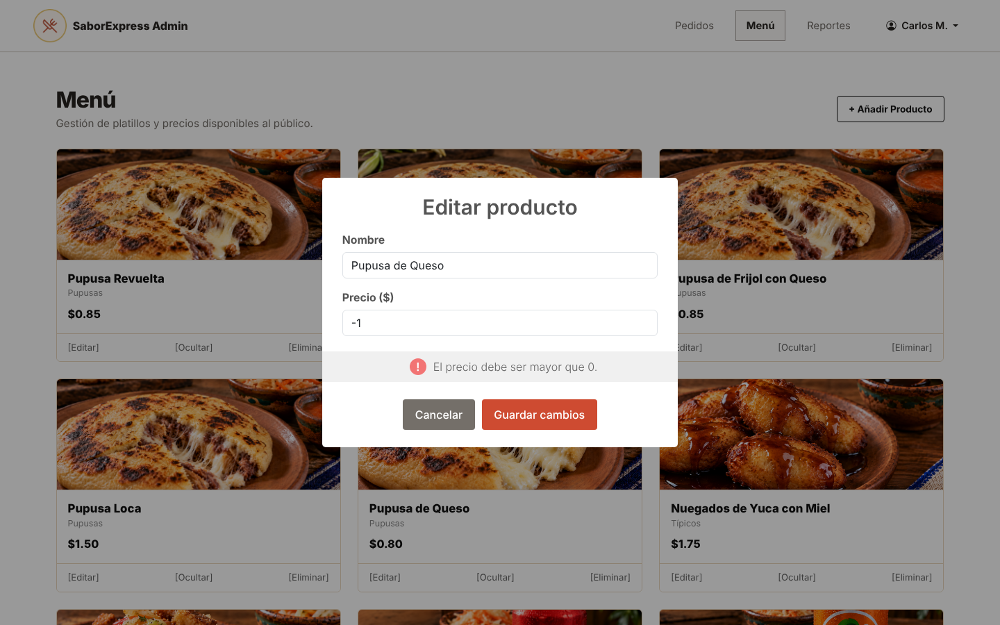
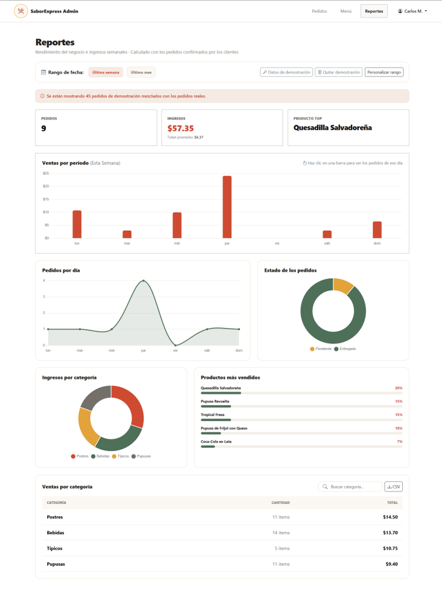

# SaborExpress

SaborExpress es una propuesta de e-commerce gastronómico orientada a la venta de pupusas y alimentos tradicionales salvadoreños. El proyecto fue desarrollado como parte de la etapa de cátedra, con el objetivo de poner en práctica conceptos de maquetación web, interacción con JavaScript, trabajo colaborativo y diseño de experiencia de usuario.

La idea principal del sistema es permitir a un cliente navegar el catálogo, elegir productos, gestionar un carrito de compras y realizar un pedido de forma sencilla, además de ofrecer un panel administrativo para administrar el menú y el estado de los pedidos.

---

## ✨ Descripción general del proyecto

El sitio se compone de varias páginas funcionales que simulan un flujo real de compra en una pupusería:

- Página principal con presentación del negocio y mensajes de promoción.
- Menú interactivo con filtros, búsqueda y paginación.
- Carrito de compras con control de cantidades y resumen de pedido.
- Proceso de registro e inicio de sesión.
- Sección de pedidos del cliente para consultar el estado de sus compras.
- Panel administrativo para gestionar productos y cambiar el estado de los pedidos.
- Área de reportes con gráficas interactivas para analizar la operación.
- Diálogos de confirmación y avisos con SweetAlert2, validación de formularios campo por campo y comprobante de pedido en PDF.
- Zona de cobertura de entregas sobre un mapa interactivo.

El enfoque del proyecto no fue crear un backend real, sino presentar una solución frontend completa con almacenamiento local mediante `localStorage`, lo cual permite simular persistencia de datos sin necesidad de una base de datos o servidor externo.

---

## 👥 Integrantes del equipo

- Abner Isaí Díaz Rivera — DR261575
- Marlene Yamileth Pérez Alvarado — PA261400
- Elias Grande Beltrán — GB261371
- Jason Steven Durán López — DL261125
- Blanca Margarita Rivas Sandoval — RS260234

El trabajo fue desarrollado en conjunto, distribuyendo tareas según los módulos del proyecto: estructura visual, estilos, lógica de JavaScript, flujo de compra, panel administrativo y documentación final.

---

## 🎯 Objetivo del sistema

El proyecto busca demostrar la capacidad del equipo para:

- diseñar una interfaz moderna y funcional para una tienda en línea;
- organizar la navegación entre páginas y secciones del sitio;
- implementar interacciones con JavaScript sin dependencias pesadas;
- manejar datos del usuario y del catálogo en el navegador;
- aplicar buenas prácticas de UX en un proyecto de tipo e-commerce institucional;
- presentar un entregable profesional de cátedra con una solución completa y coherente.

---

## 🧩 Stack tecnológico

El proyecto se desarrolló principalmente con tecnologías web estándar:

- HTML5 para la estructura de las páginas.
- CSS3 para el diseño visual y la responsividad.
- JavaScript moderno (ES Modules) para la lógica de la aplicación.
- Bootstrap 5 para la base visual y componentes reutilizables.
- Bootstrap Icons para los iconos de la interfaz.
- LocalStorage como mecanismo de persistencia de datos del navegador.
- Chart.js 4 para las gráficas del panel de reportes.
- Leaflet 1.9 y OpenStreetMap para el mapa del checkout y la zona de cobertura.
- SweetAlert2 11 para los diálogos de confirmación, avisos y formularios emergentes.
- jsPDF 2.5 para generar el comprobante del pedido en PDF.

No se empleó un framework de interfaz ni una arquitectura backend, ya que el objetivo de esta etapa era enfocarse en la lógica del front-end y la experiencia del usuario. Las librerías externas se cargan desde CDN; SweetAlert2 y jsPDF se cargan solo cuando se necesitan y, si no hay conexión, la aplicación usa los cuadros nativos del navegador.

---

## 📁 Estructura del proyecto

```text
Etapa-2-DAW/
├── admin-menu.html
├── admin-pedidos.html
├── admin-reportes.html
├── carrito.html
├── checkout.html
├── contacto.html
├── index.html
├── login.html
├── menu.html
├── mis-pedidos.html
├── nosotros.html
├── registro.html
├── css/
│   ├── admin-reportes.css
│   ├── carrito-adminmenu.css
│   ├── contacto-adminpedidos.css
│   ├── inicio-nosotros.css
│   ├── login-mispedidos.css
│   └── menu-reportes.css
├── docs/
│   └── Investigacion-Librerias-Foro1.pdf
├── img/
│   ├── capturas/
│   ├── comida/
│   ├── contacto/
│   ├── inicio/
│   ├── menú/
│   └── nosotros/
├── js/
│   ├── admin-menu.js          (CRUD del menú con SweetAlert2)
│   ├── admin-pedidos.js       (estados de pedidos, paginación)
│   ├── admin-reportes.js      (panel de reportes)
│   ├── alertas.js             (capa de diálogos SweetAlert2)
│   ├── carrito-sync.js        (el carrito se ajusta al menú vigente)
│   ├── carrito.js
│   ├── checkout.js            (validaciones, zona de cobertura, confirmación)
│   ├── cobertura.js           (local, radio de entrega y distancia)
│   ├── compra-utils.js        (tarifa de envío, límites y utilidades)
│   ├── comprobante.js         (comprobante en PDF con jsPDF)
│   ├── contacto.js
│   ├── inicio-nosotros.js
│   ├── login.js
│   ├── menu.js
│   ├── mis-pedidos.js
│   ├── registro.js
│   ├── reportes-demo.js       (datos de demostración para las gráficas)
│   ├── reportes-graficas.js   (gráficas Chart.js)
│   ├── saborexpress-data.js   (acceso a datos, sesiones y navbar)
│   └── validaciones.js        (reglas de validación reutilizables)
└── README.md
```

---

## 🛠️ Funcionalidades principales

### 1. Catálogo del menú
El módulo principal del cliente permite:

- visualizar productos con nombre, descripción, imagen y precio;
- filtrar por categorías;
- buscar productos por nombre o descripción;
- seleccionar cantidades antes de agregar al carrito;
- paginar el contenido cuando hay varios artículos.

### 2. Carrito de compras
La funcionalidad del carrito incluye:

- adicionar productos con distintas cantidades;
- mantener los datos almacenados en el navegador;
- mostrar el total acumulado;
- permitir edición antes de confirmar la compra.

### 3. Registro e inicio de sesión
La aplicación gestiona usuarios locales con base en `localStorage`, permitiendo:

- crear cuenta nueva;
- iniciar sesión con correo y contraseña;
- redirigir según el tipo de usuario;
- mantener la sesión activa durante la navegación.

### 4. Proceso de checkout
Cuando el cliente confirma su pedido, el sistema genera una orden con información de:

- cliente;
- dirección;
- teléfono;
- método de pago;
- productos seleccionados;
- total final.

Antes de confirmar se valida cada campo, se pide marcar la ubicación en el mapa y se comprueba que esté dentro de la **zona de cobertura** (5 km alrededor del local, con tarifa de envío fija). Al confirmar, el cliente puede descargar el comprobante en PDF y enviar el detalle por WhatsApp.

### 5. Mis pedidos
Los clientes pueden consultar el historial de sus compras y observar el estado actualizado por el administrador.

### 6. Panel administrativo
El admin cuenta con herramientas para:

- administrar el menú público;
- agregar productos desde un catálogo base;
- editar precios y nombres;
- eliminar productos no deseados;
- filtrar pedidos por estado;
- cambiar el estado de cada pedido (Pendiente, Preparando, En camino, Entregado, Cancelado); Entregado y Cancelado son estados finales y piden confirmación;
- ocultar o mostrar productos sin eliminarlos;
- recibir los pedidos nuevos sin recargar la página.

### 7. Reportes
La sección administrativa incluye cuatro gráficas de Chart.js (ventas por día, pedidos por día, ingresos por categoría y estado de los pedidos), indicadores clave, filtros por rango de fechas y exportación a CSV. Al hacer clic en una barra de ventas se abre el detalle de los pedidos de ese día. Para pruebas y demostraciones, el panel permite generar y quitar pedidos de ejemplo claramente identificados, sin tocar los pedidos reales.

---

## 🔐 Credenciales de demostración

Para ingresar al panel administrativo del proyecto, se usa la siguiente cuenta de prueba:

- Correo: `admin@saborexpress.com`
- Contraseña: `Admin123`

> Estas credenciales están diseñadas para pruebas del proyecto y están integradas con la lógica de autenticación local del sistema.

Los clientes se registran desde `registro.html` (contraseña de mínimo 8 caracteres, con letras y números). Las sesiones de cliente y de administrador son independientes, por lo que se pueden probar ambos roles a la vez en el mismo navegador.

---

## ▶️ Cómo ejecutar el proyecto

Como es un proyecto estático, no requiere instalación compleja.

### Con Live Server (recomendado)

1. Abre la carpeta del proyecto en Visual Studio Code.
2. Instala la extensión **Live Server**.
3. Haz clic derecho sobre `index.html` y elige **Open with Live Server**.

> El proyecto usa módulos de JavaScript (`type="module"`), por lo que **no funciona abriendo el HTML con doble clic** (`file://`): debe servirse desde un servidor local o desde el sitio publicado. Se necesita conexión a internet para cargar Bootstrap y las librerías.

**Sitio publicado (GitHub Pages):** [text](https://abnerdiazz.github.io/SaborExpress-DAW/)

**Video de demostración:** [text](https://drive.google.com/file/d/1TDZSLtAe6zYHCqH77WyTOrAhEAmyjyy2/view?usp=drive_link)

---

## 📚 Foro 1: interactividad con librerías de JavaScript

| Requerimiento | Cómo se cumple | Archivos |
| --- | --- | --- |
| Reportes con gráficas funcionales | Cuatro gráficas de Chart.js que se actualizan con los filtros de fecha; clic en una barra abre el detalle del día. | `admin-reportes.html`, `js/admin-reportes.js`, `js/reportes-graficas.js` |
| Diálogos atractivos | SweetAlert2 reemplaza a `alert`, `confirm` y `prompt` en todo el sitio, con avisos breves (toast) y formularios emergentes. | `js/alertas.js` y todas las páginas con acciones |
| Módulo adicional funcional | Zona de cobertura sobre mapa Leaflet (radio de 5 km, distancia calculada con Haversine) y comprobante de pedido en PDF con jsPDF. | `js/checkout.js`, `js/cobertura.js`, `js/comprobante.js` |
| Validaciones avanzadas | Validación por campo y en vivo, formato automático del teléfono, medidor de seguridad de contraseña, bloqueo tras 5 intentos fallidos de inicio de sesión, límites por producto y reglas de estados finales. | `js/validaciones.js`, `js/login.js`, `js/registro.js`, `js/checkout.js`, `js/contacto.js` |
| Documento de investigación (APA 7) | Explica cada librería, por qué se eligió y dónde se aplica en SaborExpress. | `docs/Investigacion-Librerias-Foro1.pdf` |

Extras de experiencia de usuario: los paneles se actualizan solos cuando otra pestaña cambia los pedidos (evento `storage`), y el carrito se ajusta si el administrador oculta un producto o cambia su precio.

---

## 📸 Capturas

Las siguientes imágenes muestran las vistas principales del sistema, tanto del lado del cliente como del panel administrativo, en escritorio y en móvil.

### Inicio

Sección principal con la presentación del negocio, llamado a la acción hacia el menú y vista previa de la sección Nosotros.


### Menú

Catálogo de productos con filtros por categoría, buscador, selección de cantidades y paginación.


### Carrito

Resumen de los productos agregados, con control de cantidades, subtotal, envío y total antes de continuar al checkout.


### Mis Pedidos

Seguimiento del pedido en curso con línea de tiempo de su estado, y tabla con el historial de pedidos anteriores del cliente.


### Admin Pedidos

Panel administrativo con filtro por estado, buscador y tabla de todas las órdenes activas del negocio.


### Registro con validaciones (Foro 1)

Validación por campo, formato automático del teléfono y medidor de seguridad de la contraseña.



### Checkout con zona de cobertura (Foro 1)

Mapa con el área de entrega, validación por campo y comprobación de la ubicación del cliente.



### Confirmación del pedido con SweetAlert2 (Foro 1)

Resumen del pedido que se muestra antes de registrarlo.



### Comprobante del pedido en PDF (Foro 1)

Comprobante generado con jsPDF al confirmar un pedido.



### Admin Pedidos: confirmación de estado final (Foro 1)

Al marcar un pedido como Entregado o Cancelado se pide confirmación, porque son estados finales.



### Admin Menú: edición con validación (Foro 1)

El cuadro de edición rechaza nombres o precios inválidos antes de guardar.



### Reportes (Foro 1)

Panel con indicadores, gráfica de ventas por día, pedidos por día, ingresos por categoría y estado de los pedidos.



<details>
<summary>Ver estas mismas vistas en móvil</summary>

**Inicio en móvil**


**Menú en móvil**


**Carrito en móvil**


**Mis Pedidos en móvil**


**Admin Pedidos en móvil**


</details>

---

## 📌 Consideraciones técnicas

- La lógica de negocio está concentrada en JavaScript del lado del cliente.
- La persistencia se realiza con `localStorage`, lo que simula almacenamiento de datos sin backend.
- La navegación y los formularios están diseñados para funcionar en un ambiente estático.
- El proyecto está orientado a una experiencia de compra simple y clara, pensada para entregar un demo funcional de negocio digital.
- Al usar `localStorage`, los datos viven en cada navegador y no se comparten entre dispositivos; la sincronización entre pestañas del mismo navegador sí funciona. La base de datos en la nube corresponde a una etapa posterior.
- La autenticación es simulada: las contraseñas se guardan sin cifrar en `localStorage` y las credenciales del administrador están en el código. Es válido para esta demostración, pero no para producción.

---

## ✅ Estado del proyecto

El proyecto se encuentra desarrollado como una propuesta funcional, con navegación completa, catálogo, carrito, autenticación, gestión administrativa y flujo de pedidos en un entorno frontend estático.

Es una solución ideal para demostrar competencias en diseño web, lógica de programación, trabajo en equipo y entrega de un producto con enfoque académico y profesional.